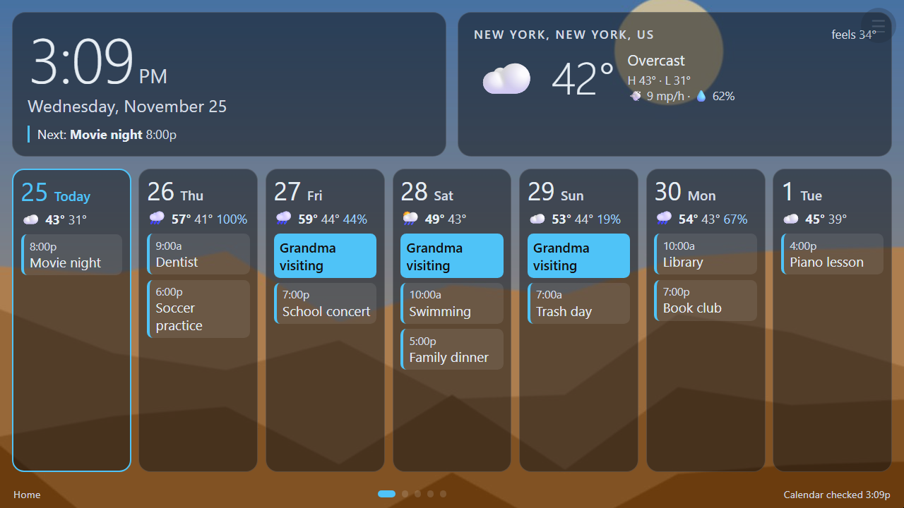
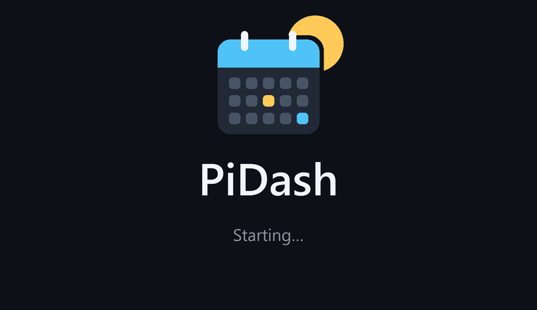

# PiDash

A family dashboard for the Raspberry Pi Zero 2 W. Flash it to an SD card, fill in
one text file, and any HDMI screen shows your Cozi calendar, the weather, countdowns
and a clock, with your own photos and videos playing behind them.

PiDash is Raspberry Pi OS Lite (Trixie, 64-bit) with a small first-boot setup added.
Nothing on the Pi can be opened from your network unless you turn SSH on.

## What it does

- **Calendar:** 7 days side by side, plus week, month and agenda pages. Works with the
  Cozi shared calendar link, and with Google, Outlook and iCloud secret iCal links. It
  looks for changes every 2 minutes.
- **Weather:** now, 12 hours and 7 days from [Open-Meteo](https://open-meteo.com/). No account needed.
- **Background slideshow:** photos from the `photos` folder and videos from the `videos`
  folder. The Pi makes a small copy of each video first, so phone clips should play.
- **Layouts and themes:** 5 layouts, 4 themes, screen rotation, text size, night dimming
  and automatic page changes. Use a touchscreen, a keyboard or push buttons.
- **Made for 512 MB of memory:** the page only redraws when something changes, and a
  watchdog restarts the screen if it freezes.
- **Splash screen** instead of startup text.

## Status

This is a hobby project, so please expect rough edges.

- **Working on a real Pi Zero 2 W:** setup, the calendar, weather, the stacked layout,
  drawing without the 3D chip, and updating from the SD card.
- **Only tested on a PC so far:** video playback, the splash screen and the hidden
  startup text. Reports are welcome in Issues.
- **Space:** Windows can only write to the 500 MB boot partition, so photos and videos
  share about 420 MB on any size of card.

## Set it up

You need a Raspberry Pi Zero 2 W, a microSD card of 8 GB or more, an HDMI screen and 2.4 GHz Wi-Fi.

1. Download `pidash.img.xz` from [Releases](https://github.com/Hottuck71/PiDash/releases), or build it
   yourself (see below). Flash it with Raspberry Pi Imager ("Use custom").
   Answer **No** when it offers OS customisation.
2. Put the card back in your PC, open the drive called **bootfs** and edit
   `dashboard-settings.txt`: Wi-Fi, calendar link, weather location, time zone and **a new
   password**.
3. Put the card in the Pi and switch it on. The first start downloads the screen software
   and takes 15 to 30 minutes.

To get the Cozi link, sign in at my.cozi.com on a computer, then go to Settings >
Shared Cozi Calendars and copy the feed (ICS) link. Treat it like a password: anyone
who has it can read your calendar.

Everything else (controls, settings, updates, troubleshooting) is in
[pi-dashboard/README.txt](pi-dashboard/README.txt), which is also copied to the card.

## Build the image

This works on Windows with Python 3. Only the FAT boot partition of the official image is changed.

1. Download **Raspberry Pi OS Lite (64-bit, Trixie)** from
   [raspberrypi.com](https://www.raspberrypi.com/software/operating-systems/) and save the
   `.img.xz` as `build/dl/base.img.xz`.
2. Run `build\build-image.bat`. The result is `build\outputs\pidash.img`.

## How it works

| Path | What it is |
|---|---|
| `pi-dashboard/app/server.py` | Local server (Python standard library): calendar, weather, photos, videos |
| `pi-dashboard/app/static/` | The dashboard page |
| `pi-dashboard/boot/pidash/setup.sh` | Installs PiDash on first start, and updates it when the `pidash` folder on the card changes |
| `pi-dashboard/boot/pidash/pidash-kiosk` | Starts Chromium full screen inside [cage](https://github.com/cage-kiosk/cage) |
| `pi-dashboard/boot/pidash/pidash-watchdog` | Restarts a frozen screen and keeps a health log on the card |
| `pi-dashboard/boot/pidash/pidash-splash` | Splash screen, with no extra packages |
| `pi-dashboard/build_image.py` | Puts it all into the official image |

## License

The PiDash code in this repository is under the [MIT license](LICENSE). The ready-made image
also contains Raspberry Pi OS, whose parts have their own licenses (see `/usr/share/doc` on the Pi).

## Credits

Designed by [Hottuck71](https://github.com/Hottuck71). The code was written with
[Claude Code](https://claude.com/claude-code), Anthropic's AI coding tool.

Not connected with Cozi, Raspberry Pi Ltd or Open-Meteo. Their names belong to them.
